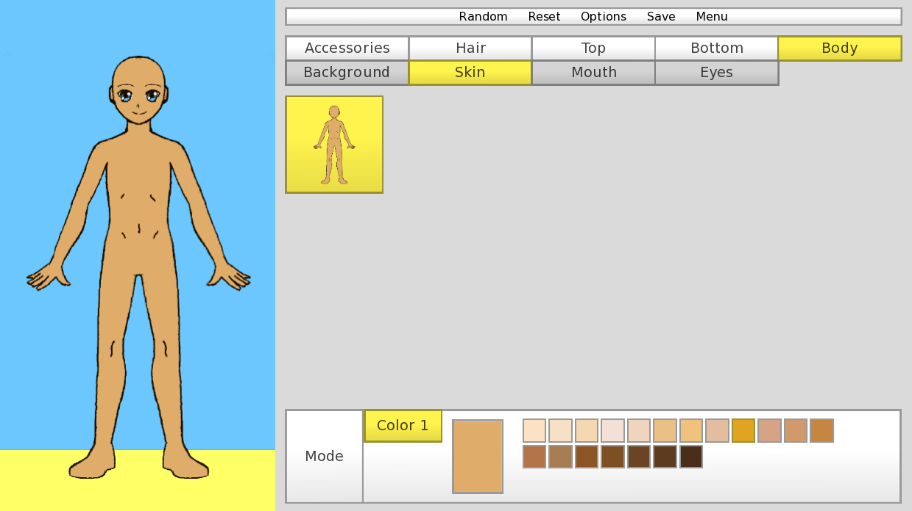
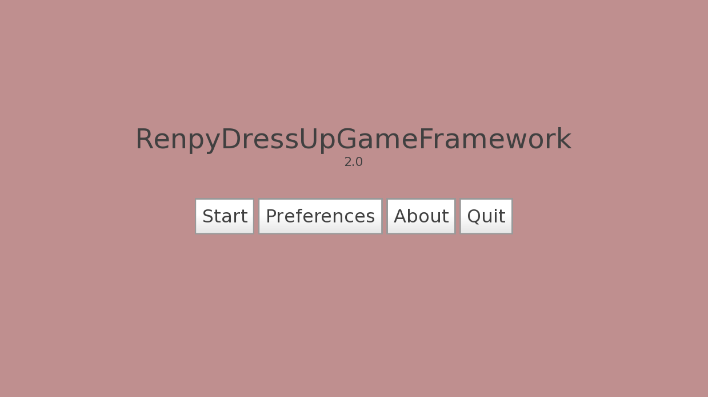

# Dress-Up Framework

A modular plug-and-play character creator and dress-up framework for Ren'Py, compatible with both web and desktop builds.

Assets are loaded directly from the image set. After creating or modifying assets, run the metadata generator to automatically build the data required by the framework.

<div>
  
  
</div>

## Quick Start

### 1. Install the Framework

Copy the framework files (The `RenpyDressUpGameFramework` directory) into your Ren'Py SDK project. The framework itself is packaged inside a game project.

### 2. Create an Image Set

Replace the images inside the IMAGESET_PATH directory with your own assets using the naming conventions described in the Asset Structure section below.

### 3. Generate Metadata

Run:

```bash
python generate_metadata.py IMAGESET_PATH
```

This generates `doll_data.json` and all metadata required by the framework for your assets.


### 4. Configure the image set layers

Edit the doll_category_data.json to your liking. Detailed explainations are available in the dedicated section.


### 5. Launch the Project

Start your Ren'Py project. The framework will automatically discover available groups, categories, items, and thumbnail data.


## Requirements

- Ren'Py 8.5.3 (development and test target)
- Python 3.x (metadata generation)

The framework can be copied directly into a project created with the Ren'Py 8.5.3 SDK. Other versions may work but are untested.

## Dependencies

The metadata generator requires Pillow:

```bash
pip install pillow
```

The runtime framework itself has no additional Python dependencies beyond Ren'Py.

## How It Works

The framework automatically discovers clothes, hairstyles, facial features, accessories, and other doll layers from a structured image set.

The metadata generator:

- Resizes assets to the framework resolution.
- Detects doll dimensions.
- Generates thumbnail crop data.
- Counts available items.
- Creates `doll_data.json`.

The generated metadata is stored in `doll_data.json` at the root of the image set.

## Asset Structure

### Folder Naming

Category folders must follow this format:

```text
<priority> - <group> - <category>
```

Example:

```text
0 - body - skin
10 - hair - back_hair
20 - hair - front_hair
30 - face - eyes
40 - face - mouth
50 - clothes - shirts
60 - clothes - jackets
70 - accessories - glasses
```

Where:

- `priority` determines render order.
- `group` determines the top-level navigation tab.
- `category` determines the selectable category within that group.

No two category should have the same name. One of the two will be overidden.

The framework imposes 5 different category names and fine different group names.

### File Naming

Items inside a category folder must be named:

```text
<category>_<index>.PNG
```

Example:

```text
50 - clothes - shirt/

shirt_0.PNG
shirt_1.PNG
shirt_2.PNG
```

The category name in the filename must match the category defined in the folder name.

## Navigation Structure

Groups become the first navigation row.

Example:

```text
10 - hair - front_hair
20 - hair - back_hair
30 - hair - eyebrows

40 - face - eyes
50 - face - mouth

60 - clothes - shirts
70 - clothes - pants
```

Produces:

```text
Hair
Face
Clothes
```

Categories become the second navigation row.

Example:

```text
Hair
├── Front Hair
├── Back Hair
└── Eyebrows
```

## Configuration

### Imageset Configuration

The doll_category_data file contains the following parameters.

#### Channels

Defines the order in which the red, green, blue and gray channels are interpreted. The fixed framework mapping is:
* unmutable color.
* mutable color 1.
* mutable color 2.
* mutable color 3.

#### Skin_layer

The category key containing the skin.

#### Default_category

The default selected category key.

#### Default_group

The default selected category group.

#### Category_config

The config details for each category. A category key has two suppliable parameters:
- base_index : if provided, the index of the preselected item.
- manager : the color manager used by the category.

Please see the ColorManager.rpy file for more details.

### Framework Configuration

All the configuration options with detailed explanations are available in (dressup_config.rpy)[RenpyDressUpGameFramework/game/dressup/dressup_config.rpy].

## Image Requirements

- PNG only.
- Assets are automatically resized by the generator.
- Optimized source images are recommended for web builds.

## Asset Credits

- [Better Colorize for Ren'Py](https://feniksdev.itch.io/better-colorize-for-renpy) by Feniksdev
- [Color Picker for Ren'Py](https://feniksdev.itch.io/color-picker-for-renpy) by Feniksdev
- [Demo Character Assets 1](https://bigeishe.itch.io/shugo-chara-dress-up) by Bigeishe
- [Demo Character Assets 2](https://bigeishe.itch.io/digital-doll) by Bigeishe

## Games using the framework

- [Shugo Chara Dress-up](https://bigeishe.itch.io/shugo-chara-dress-up) by Bigeishe
- [Digital Doll](https://bigeishe.itch.io/digital-doll) by Bigeishe

## License

This project is licensed under the Apache License 2.0.

You are free to use, modify, and distribute this software in accordance with the terms of the license.

See the [LICENSE](LICENSE) file for the full license text, or visit the official Apache License page:

- https://www.apache.org/licenses/LICENSE-2.0
